# K-Mant · Maintenance management

> A company's maintenance, organized end to end: equipment, failures, work orders,
> preventive maintenance, spare parts, purchasing and KPIs in one system, in the
> office, on the plant floor and on the technician's phone.

**Status:** available for guided demos ·
**Proprietary system** by Kusarive Solutions LLC ·
[Versión en español](README.md) ·
[Presentation page](https://rjblancos.github.io/kmant-showcase/) ·
**[Download the presentation as PDF](presentacion/K-Mant-presentacion.pdf)** (36 slides, in Spanish)

---

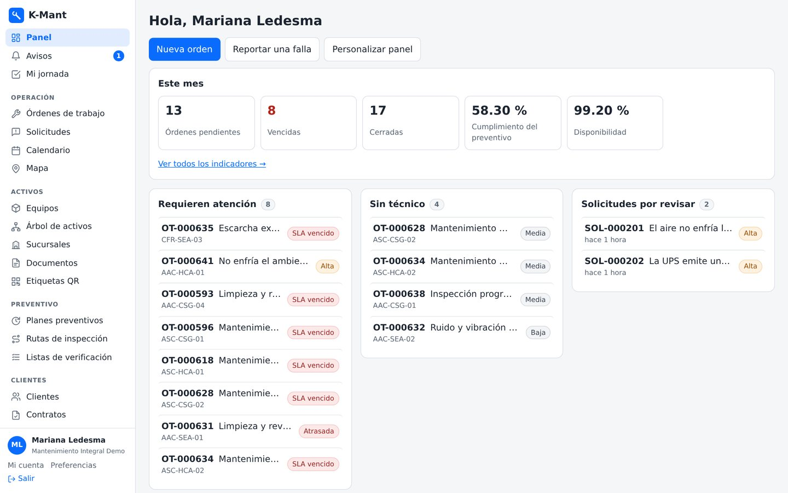

*The dashboard of a service company: pending and overdue orders, preventive
compliance, availability and what needs attention. Test environment with made-up
data. The interface is in Spanish.*

## The problem

In many companies a failure is reported in a chat and gets lost among messages, the
equipment has no history, preventive maintenance depends on someone remembering,
spare parts are not tracked, the technician fills in paper forms and, when management
asks about the availability or cost of a piece of equipment, nobody has the number.

K-Mant runs the whole cycle in one system:

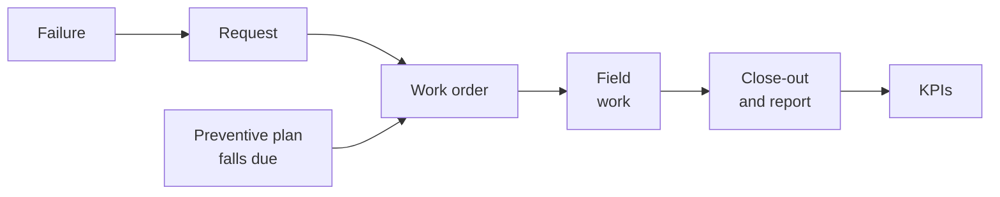

It works in two modes: **the company that maintains its own equipment** (plants,
industries, buildings) and **the service company that maintains other companies'
equipment**, with contracts, response times, quotes and a portal for each customer.

## What it does

- **Equipment and assets.** A record for each piece of equipment: technical sheet per
  equipment type, history of orders, downtime, parts and costs, components as a tree
  and meters (hours, kilometers, cycles). QR or NFC tag, site map, asset tree and
  spreadsheet import.
- **Requests.** Anyone reports a failure from a phone, even without an account, by
  scanning the equipment's QR code. If the equipment already has an open order, the
  failure is added to it.
- **Work orders.** Board by status, crews, service commitments with response and
  resolution deadlines, and escalation to management when something critical is not
  handled. A piece of equipment never has two open orders at once.
- **Execution and close-out.** Waits with their reason, hours per technician, parts
  from inventory, mandatory versioned checklists, photos and video, sign-off
  signature and a PDF report with an authenticity code.
- **The technician, from a phone.** Their day and route; with no signal, it saves and
  sends when coverage returns. Installs like an app.
- **Preventive.** Time- or usage-based plans that create their own order when due,
  overdue traffic light, calendar and inspection routes.
- **Inventory and purchasing.** Stock per warehouse (including the service van),
  reservations per order, suggested restocking, purchases approved by amount, and each
  supplier's codes translated to your own product.
- **For service companies.** Customers with sites and contracts, quotes the customer
  approves from their portal, and a portal where they see their equipment, orders,
  reports and KPIs, never another customer's.
- **KPIs.** Availability, MTBF, MTTR, preventive and service-commitment compliance,
  equipment with the most downtime and costs, as PDF or spreadsheet.
- **Tailored.** Your own words, country, currency, time zone, work calendar, brand on
  reports and custom roles.

## Screenshots

| Work order board | Work order |
|---|---|
| 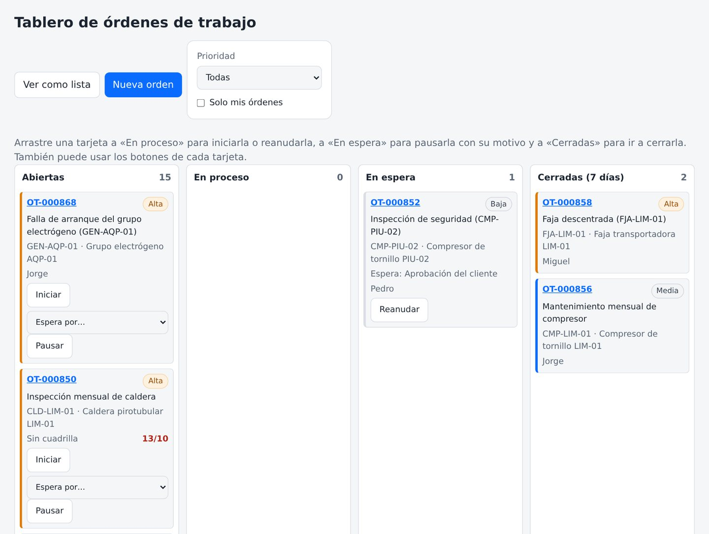 | 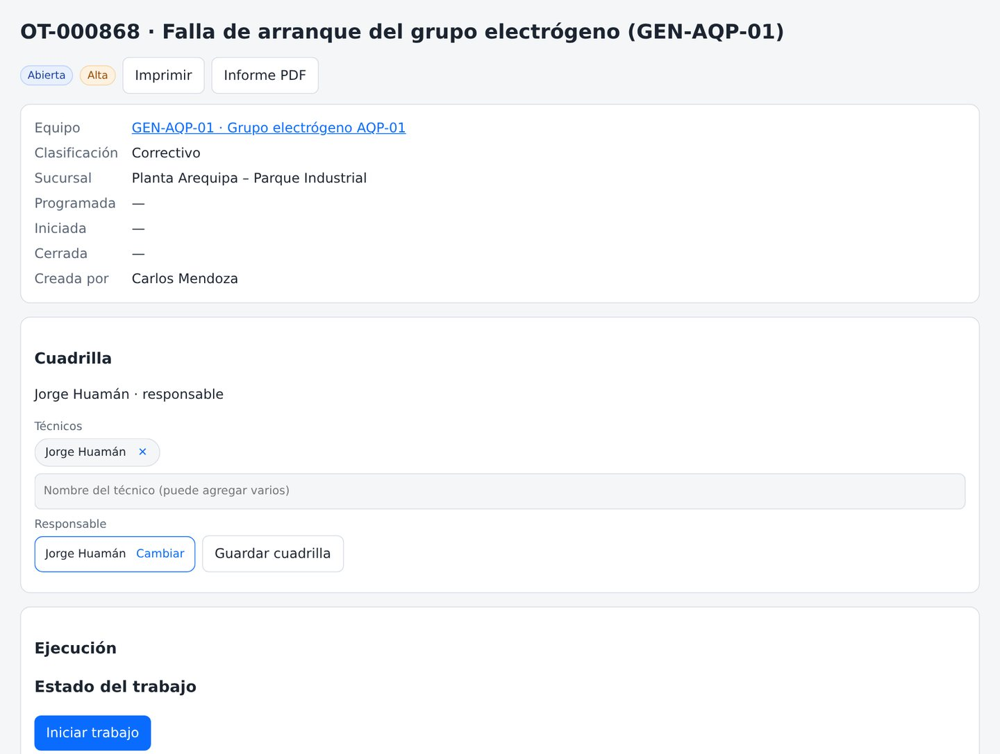 |

| Asset tree | Calendar |
|---|---|
| 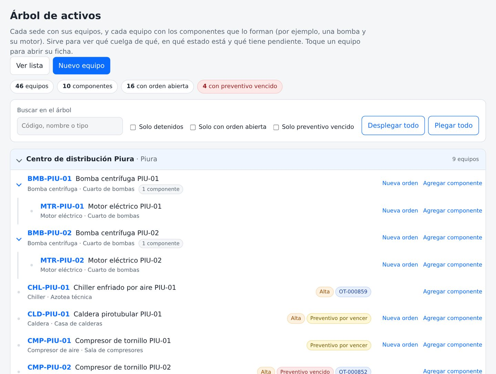 | 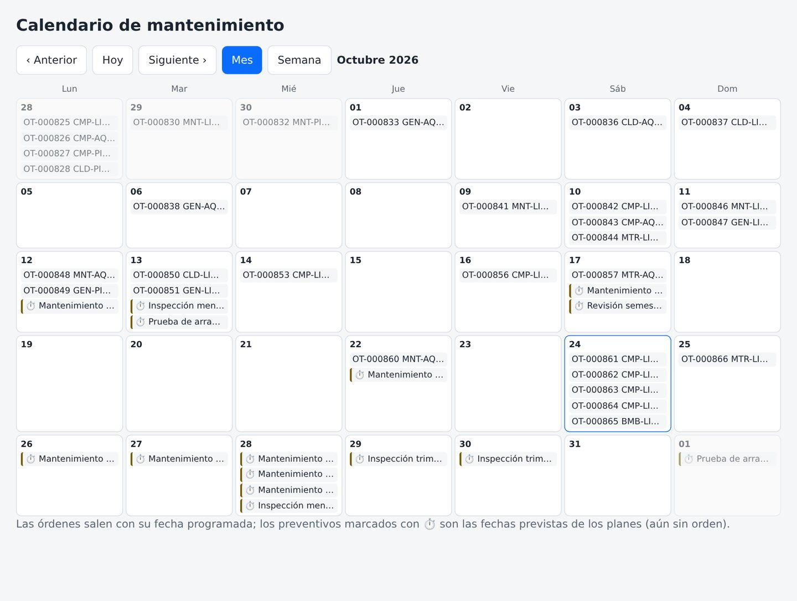 |

| Preventive plans | KPIs |
|---|---|
| 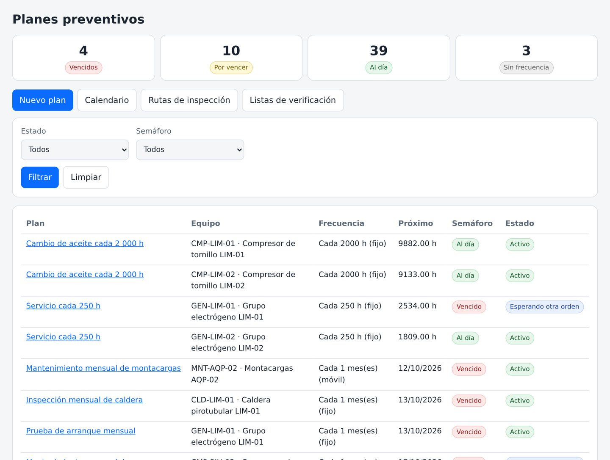 | 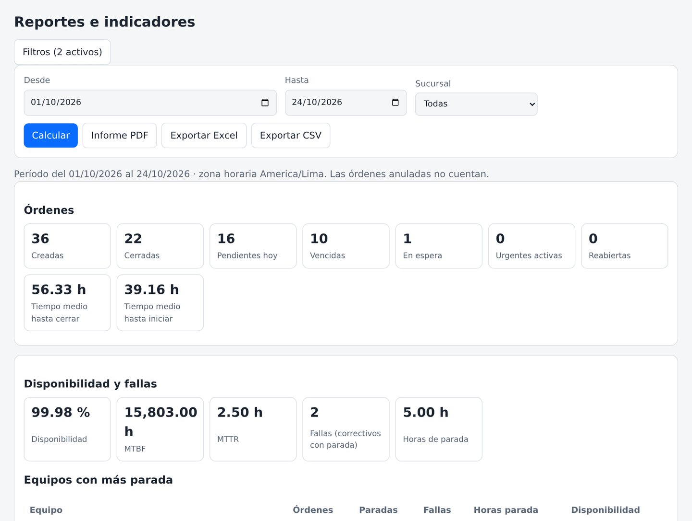 |

| Inventory | Quotes |
|---|---|
| 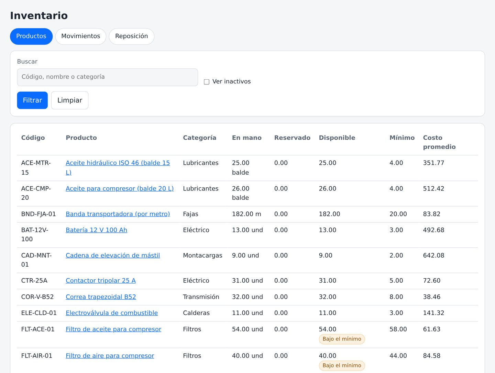 | 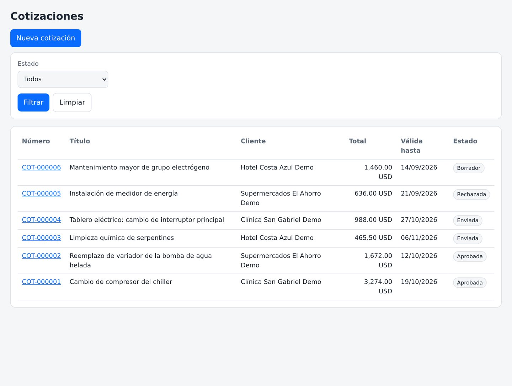 |

| Customer portal |
|---|
| 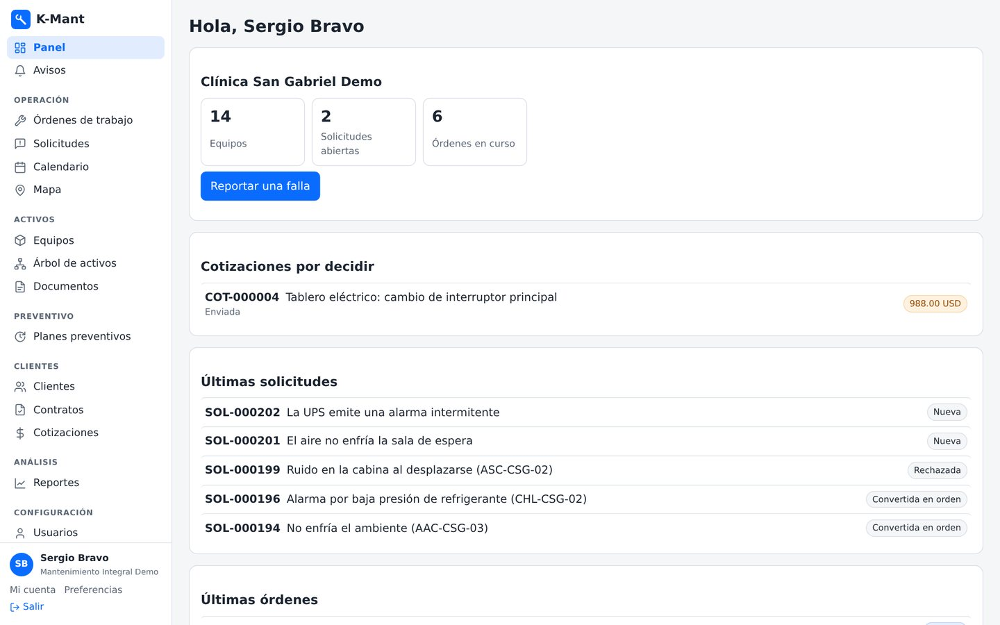 |

| The technician's day | The order on a phone | QR report, no account |
|---|---|---|
| 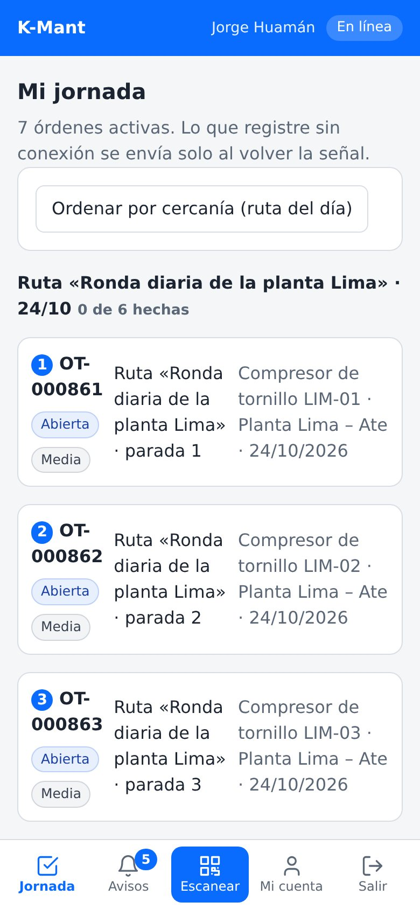 | 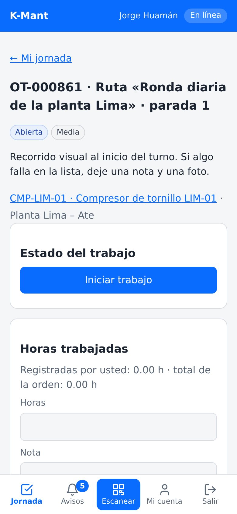 | 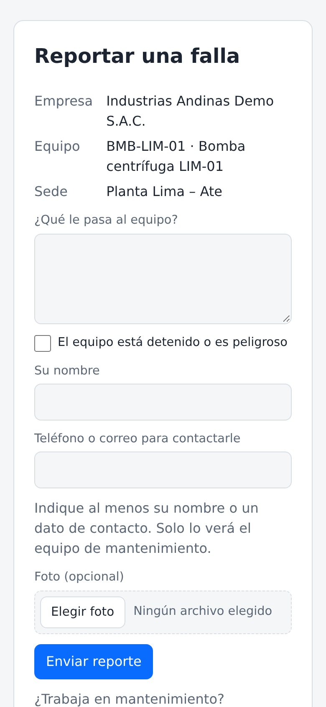 |

Test environment with made-up companies, equipment, people and orders.

## Roles

| Role | What they do |
|---|---|
| Administrator | Company, users, roles, settings and purchase approval. |
| Supervisor / planner | Requests, orders, crews, equipment, preventive, routes, checklists and customers. |
| Technician | Their day on the phone: works and closes their orders. |
| Subcontractor | Only the orders assigned to them. |
| Requester | Reports failures and follows their requests. |
| Storekeeper | Inventory, movements, warehouses and restocking. |
| Buyer | Purchases and suppliers. |
| Read-only / auditor | Sees everything, changes nothing. |
| Customer users | Administrator, supervisor, requester or read-only, limited to their own company. |

Each company can also create its own roles, permission by permission.

## Technical guarantees

| Area | What the system guarantees |
|---|---|
| **Isolation** | Multi-company: no company or customer ever sees another's data. |
| **Sealed audit trail** | Every change is chained with a verifiable digital fingerprint. |
| **Access** | A 6-digit code for administrators signing in from a new device. |
| **Orders** | A piece of equipment never has two open orders; preventive waits or merges, never duplicates. |
| **Evidence** | Photos, video and documents with their fingerprint; PDF report with a code to check it is authentic. |
| **Your data** | Full company backup as a ZIP, password-encrypted if desired. |
| **Integration** | JSON or XML API, with keys per system. |
| **Quality** | Over 500 automated tests cover permissions, isolation, orders, preventive, inventory and reports. |

## Built with

| Language | Where | Approximate size |
|---|---|---|
| **PHP** | Logic: orders, preventive, inventory, purchasing, permissions, reports and API | 21,200 lines |
| **PHP (templates)** | The screens | 4,800 lines |
| **JavaScript** | Offline work, scanning, board and installable app | 750 lines |
| **SQL** | Multi-company storage | — |

GitHub's language bar only measures the files in this repository, which is
documentation.

## By the numbers

- **Over 500 automated tests** (531 as of 27-Oct-2026).
- **13 user roles**: 9 system roles and 4 for customer users.
- **13 manuals** with real screenshots: the general one and one per role, inside the system.
- **36-slide presentation**, [downloadable as PDF](presentacion/K-Mant-presentacion.pdf) (in Spanish).

## See it working with your own equipment

A 30-minute guided demo: your equipment, your typical failures and the way you work.

Rafael Blanco, for Kusarive Solutions LLC

- Web: [k-mant.com](https://k-mant.com)
- Email: soporte@k-mant.com
- WhatsApp: [+1 407 337 0061](https://wa.me/14073370061)
- Presentation: [36-slide PDF](presentacion/K-Mant-presentacion.pdf)

## What's new

- **27-Oct-2026** · Showcase published, with a downloadable PDF presentation.

Full log: [CHANGELOG.md](CHANGELOG.md).

© 2026 Kusarive Solutions LLC. See [LICENSE](LICENSE).
