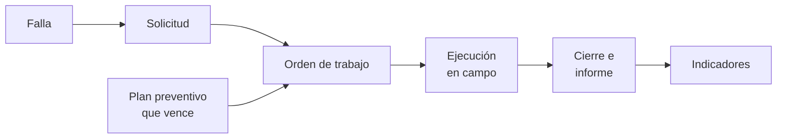

# K-Mant · Gestión de mantenimiento

> El mantenimiento de una empresa, ordenado de punta a punta: equipos, fallas,
> órdenes de trabajo, preventivo, repuestos, compras e indicadores en un solo
> sistema, en la oficina, en planta y en el teléfono del técnico.

**Estado:** disponible para demostración guiada ·
**Sistema propietario** de Kusarive Solutions LLC ·
[English version](README.en.md) ·
[Página de presentación](https://rjblancos.github.io/kmant-showcase/) ·
**[Descargar la presentación en PDF](presentacion/K-Mant-presentacion.pdf)** (36 diapositivas)

---

*El panel de una empresa de servicio: órdenes pendientes y vencidas, cumplimiento
del preventivo, disponibilidad y lo que requiere atención. Ensayo con datos
inventados.*

## Qué resuelve

En muchas empresas la falla se avisa por un chat y se pierde entre mensajes, el
equipo no tiene historia, el preventivo depende de que alguien se acuerde, los
repuestos no se controlan, el técnico llena papeles y, cuando gerencia pregunta por
la disponibilidad o el costo de un equipo, nadie tiene la cifra.

K-Mant lleva todo el ciclo en un solo sistema:

Sirve en dos modos: **la empresa que mantiene sus propios equipos** (plantas,
industrias, edificios) y **la empresa de servicio que da mantenimiento a otros**,
con contratos, tiempos de respuesta, cotizaciones y un portal para cada cliente.

## Qué hace

- **Equipos y activos.** Hoja de vida de cada equipo: ficha técnica propia de cada
  tipo, historial de órdenes, paradas, repuestos y costos, componentes en árbol y
  contadores (horas, kilómetros, ciclos). Etiqueta QR o NFC, mapa de sedes, árbol de
  activos e importación desde hoja de cálculo.
- **Solicitudes.** Cualquiera reporta una falla desde el teléfono, incluso sin cuenta,
  escaneando el QR del equipo. Si el equipo ya tiene una orden abierta, la falla se
  suma a ella.
- **Órdenes de trabajo.** Tablero por estado, cuadrillas, compromiso de servicio con
  hora límite de respuesta y de solución, y escalado a la jefatura si lo crítico no se
  atiende. Un equipo nunca tiene dos órdenes abiertas a la vez.
- **Ejecución y cierre.** Esperas con su motivo, horas por técnico, repuestos del
  inventario, listas de verificación obligatorias y con versiones, fotos y vídeo,
  firma de conformidad e informe PDF con código de autenticidad.
- **El técnico, desde su teléfono.** Su jornada y su ruta del día; si no hay señal,
  guarda y envía al volver la cobertura. Se instala como una aplicación.
- **Preventivo.** Planes por tiempo o por uso que generan su orden solos cuando
  vencen, semáforo de vencidos, calendario y rutas de inspección.
- **Inventario y compras.** Existencias por almacén (también el de la camioneta),
  reservas por orden, reposición sugerida, compras con aprobación según el monto y
  códigos de cada proveedor que se traducen al producto propio.
- **Para empresas de servicio.** Clientes con sedes y contratos, cotizaciones que el
  cliente aprueba desde su portal, y un portal donde ve sus equipos, órdenes, informes
  e indicadores, nunca los de otro cliente.
- **Indicadores.** Disponibilidad, MTBF, MTTR, cumplimiento del preventivo y del
  compromiso de servicio, equipos con más paradas y costos, en PDF u hoja de cálculo.
- **A su medida.** Sus palabras («OT», «Sede»…), país, moneda, zona horaria, calendario
  laboral, marca en los informes y roles propios.

## Capturas

| Tablero de órdenes | Orden de trabajo |
|---|---|
|  |  |

| Árbol de activos | Calendario |
|---|---|
|  |  |

| Planes preventivos | Indicadores |
|---|---|
|  |  |

| Inventario | Cotizaciones |
|---|---|
|  |  |

| Portal del cliente |
|---|
|  |

| La jornada del técnico | La orden en el teléfono | Reporte por QR, sin cuenta |
|---|---|---|
|  |  |  |

Ensayo con empresas, equipos, personas y órdenes inventados.

## Roles

| Rol | Qué hace |
|---|---|
| Administrador | Empresa, usuarios, roles, configuración y aprobación de compras. |
| Supervisor / planificador | Solicitudes, órdenes, cuadrillas, equipos, preventivo, rutas, listas y clientes. |
| Técnico | Su jornada en el teléfono: ejecuta y cierra sus órdenes. |
| Subcontratista | Solo las órdenes que le asignan. |
| Solicitante | Reporta fallas y sigue sus solicitudes. |
| Almacenista | Inventario, movimientos, almacenes y reposición. |
| Comprador | Compras y proveedores. |
| Solo lectura / auditor | Consulta todo sin cambiar nada. |
| Usuarios del cliente | Administrador, supervisor, solicitante o solo lectura, solo con lo de su empresa. |

Además, cada empresa puede crear roles propios permiso a permiso.

## Garantías técnicas

| Área | Qué garantiza el sistema |
|---|---|
| **Aislamiento** | Multiempresa: ninguna empresa ni cliente ve los datos de otro. |
| **Auditoría sellada** | Cada cambio queda encadenado con una huella digital que se puede verificar. |
| **Acceso** | Código de 6 dígitos para los administradores al entrar desde un dispositivo nuevo. |
| **Órdenes** | Un equipo no admite dos órdenes abiertas; el preventivo espera o se suma, nunca duplica. |
| **Evidencias** | Fotos, vídeo y documentos con su huella; informe PDF con código para comprobar que es auténtico. |
| **Sus datos** | Respaldo completo de la empresa en un ZIP, cifrado con contraseña si se desea. |
| **Integración** | API en JSON o XML, con claves por sistema. |
| **Calidad** | Más de 500 pruebas automáticas cubren permisos, aislamiento, órdenes, preventivo, inventario e informes. |

## Construido con

| Lenguaje | Dónde | Tamaño aproximado |
|---|---|---|
| **PHP** | Lógica: órdenes, preventivo, inventario, compras, permisos, informes y API | 21.200 líneas |
| **PHP (plantillas)** | Las pantallas | 4.800 líneas |
| **JavaScript** | Trabajo sin conexión, escaneo, tablero y app instalable | 750 líneas |
| **SQL** | Almacenamiento multiempresa | — |

La barra de lenguajes de GitHub mide solo los ficheros de este repositorio, que es
documentación.

## En cifras

- **Más de 500 pruebas automáticas** (531 al 27-oct-2026).
- **13 roles** de usuario: 9 del sistema y 4 para los usuarios del cliente.
- **13 manuales** con capturas reales: el general y uno por cada rol, dentro del sistema.
- **36 diapositivas** de presentación, [descargables en PDF](presentacion/K-Mant-presentacion.pdf).

## Véalo funcionando con sus propios equipos

Demostración guiada de 30 minutos: sus equipos, sus fallas típicas y su forma de
trabajar.

- Web: [k-mant.com](https://k-mant.com)
- Correo: soporte@k-mant.com
- WhatsApp: [+1 407 337 0061](https://wa.me/14073370061)
- Presentación: [PDF de 36 diapositivas](presentacion/K-Mant-presentacion.pdf)

## Novedades

- **27-oct-2026** · Publicación de la vitrina, con su presentación en PDF descargable.

Registro completo: [CHANGELOG.md](CHANGELOG.md).

© 2026 Kusarive Solutions LLC. Ver [LICENSE](LICENSE).
